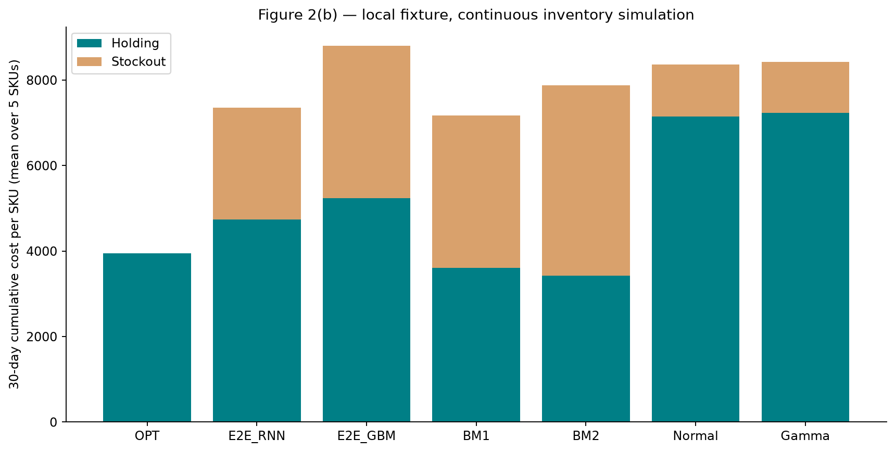

# 离线复现实验结果

本报告由实际运行输出生成。范围为论文第 3、4 章与附录 B；按用户要求不运行第 5 章。

**以下图表对应论文的实验问题和绘图形式，但数值来自公开五条销量序列与明确的库存仿真设定，不是论文全样本数值。** 不用作者提供的 3000 条测试预测来训练网络，不用虚构的未来需求替代真实销量。

## 运行范围

- 5 条真实销量序列，每条 457 个日编号；日期映射缺失，保留相对顺序。
- 历史窗口 180 天；固定 L=5，取公开唯一 VLT 示例 4.9705 天向上取整。示例标识不能关联到销量 SKU，因此这是跨 SKU 统一的仿真假设，不是其真实交货期。
- 固定复核周期 R=7；训练库存覆盖水平为保护期历史平均需求的 0、0.5、1 倍。库存示例无法关联，不将构造状态说成观测库存。
- 按时间 60%/20%/20% 分区，去掉跨区目标窗口，7 天步长。训练/验证/测试样本数：{'train': 180, 'validation': 180, 'test': 180}。同一时点三种库存状态并非三个独立 SKU。
- 只在最后 30 天进行连续库存仿真，库存与订单逐日传递，允许积压，先到货再扣需求。初始库存为过去 180 天均值乘以 L+R；无初始在途订单。
- E2E、BM1、BM2 分别训练，BM1 直接预测总需求分位数；BM2 预测每日需求。分位数按验证期库存成本选择，未使用测试结果挑选。固定 VLT 实验使用已知 L，而非网络 VLT 输出，避免伪装成随机 VLT 实验。

## Figure 2(b) 对应的策略比较

| 策略 | 持有成本 | 缺货成本 | 总成本 |
|---|---:|---:|---:|
| OPT | 3942.91 | 0.00 | 3942.91 |
| E2E_RNN | 4733.90 | 2621.11 | 7355.01 |
| E2E_GBM | 5237.02 | 3565.53 | 8802.54 |
| BM1 | 3603.94 | 3564.16 | 7168.10 |
| BM2 | 3422.58 | 4456.77 | 7879.35 |
| Normal | 7145.15 | 1216.88 | 8362.03 |
| Gamma | 7229.44 | 1192.21 | 8421.64 |

单位是每 SKU 的 30 天累计成本，再对 5 个 SKU 等权平均。不同策略有各自连续库存轨迹；OPT 使用未来真实销量，是确定性下界。所有策略都在同一需求、初始库存、订货时点和到货时点下比较。

这张表如出现 E2E 不优于其他模型，照实保留；小样本、构造库存、缺失特征、优化器和分布变化都可能影响结果，不通过挑选测试集或调整图轴来迎合原文。

## 其余产物

- `figures/figure_1_architecture.png`：按 Figure 1 组织的三输出结构。
- `figures/figure_2a_forecasts.png`：预先固定前三个 SKU 的多分位数预测，未挑选最优示例。
- `appendix_sensitivity.csv`、`table_B*.csv`：层数、隐藏维度、学习率、训练样本量、随机种子实验。
- `figures/figure_B1_training_size.png`：训练样本量—成本/耗时。
- `figures/figure_B2_cost_ratio.png`：b/h=(1, 3, 9, 19)；每种比值重新生成标签并训练。
- `figures/figure_B3_initialization.png`：两个随机种子的 VLT 第一层权重。
- `released_3000_diagnostics.csv`：作者预测及 Eq. (7)/(8) 在公开测试记录上的订货量误差诊断；没有声称得到其真实库存成本。
- `verification.json`：模型保存/重载逐值一致、完美信息 OPT 下界检查。
- `training_history.csv`：所有实际训练日志，包含未改善的实验。

Figure 2(a) 三条预测中出现 0 个 10%/90% 分位数交叉点。模型未加单调约束，绘图不偷偷排序；交叉反映拟合限制。

## 与原论文的差异

Table B.1 的隐藏维度、VLT 层、融合层、SGD 动量、学习率、batch size、初始化和 dropout 已落实。原文未充分说明的 LSTM/全局局部解码器细节、损失范数、辅助权重、学习率衰减形式和早停以代码与配置为准，属于独立实现选择。

原文写 Q=6，却同时列出均值和六个分位数；Figure 2(a) 又使用中位数。实现输出均值 + 10/50/60/70/80/90/95% 七个分位数，中位数用于可视化，BM 候选使用均值及原文列出的六分位数。没有把各日分位数之和当成总需求的分位数。

训练集不是原文的 24333 SKU / 前30天订单，敏感性样本比例也不是原文 SKU 子集比例。当前数据只能对同五个 SKU 的训练窗口做比例分析；没有统计显著性或跨数据集泛化主张。固定 VLT 的第一层权重图只验证不同初始化的模型行为，不能支持随机供应商交货期学习结论。

原始 `df_test.csv` 只提供预测、摘要和定义为历史需求的 `demand_hist`，缺少可靠的未来轨迹与真实到货。不能把其历史需求当未来需求来重建原文成本。原文 Figure 2(b)、Tables B.2–B.6 的全样本数值仍无法精确对齐，原因明确记录在 `docs/REPRODUCTION_MAP.md`。

本次没有收集额外数据；没有进行实地实验；没有将论文中的原始数值复制到“复现结果”列。
